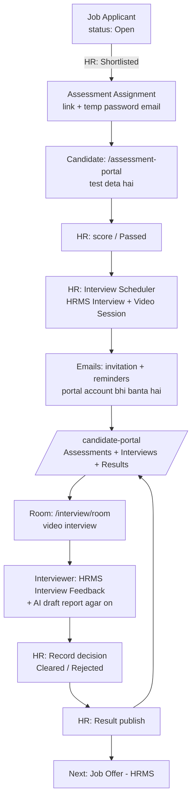

# Interview Flow — Shortlist se Interview Result tak

Site: `griderp.in` (ERPNext v16 + HRMS + `grid_erp`, module **Grid Interview**)
Last verified: 2026-10-20 (merge ke baad, staging par) · Andar ki detail + code tree: [interview-internals.md](interview-internals.md)

Yeh document batata hai ki HRMS ka interview Grid Interview ke saath kaise chalta hai: schedule,
emails, **candidate portal**, video room, recording, AI report aur result. Kaun kya karta hai, aur
kuch atke toh kahan dekhna hai. Assessment wala hissa [recruitment.md](recruitment.md) mein hai.

---

## 1. Ek line mein

> **HRMS interview ka "record" rakhta hai. Grid Interview uske upar scheduling, emails, candidate
> portal, video room, recording aur AI report ka kaam karta hai.**

Grid Interview HRMS ka code, DocTypes ya fields **nahi badalta**. HRMS ke apne records (Job
Applicant, Interview, Interview Type, Interview Feedback) waise hi use hote hain; apna extra data
Grid Interview apne alag DocTypes mein rakhta hai.

```
 ┌──────────────────────── HRMS (pehle se tha) ────────────────────────┐
 │  Job Opening → Job Applicant → Interview (Interview Type ke saath)   │
 │                                   └→ Interview Feedback (interviewer)│
 └───────────────────────────────▲─────────────────────────────────────┘
                                 │ padhta hai / HR ke naam se banata hai
 ┌──────────────────────── Grid Interview (grid_erp module) ───────────┐
 │  Video Session · Emails · Candidate Portal · Room · Recording        │
 │  Transcript · AI Analysis · Result · References · Audit Log          │
 └──────────────────────────────────────────────────────────────────────┘
```

---

## 2. Poora recruitment flow ek nazar mein (Assessment + Interview)



| # | Step | Kaun | Kahan |
|---|------|------|-------|
| 1 | Shortlist + assessment | HR / system | Job Applicant ([recruitment.md](recruitment.md)) |
| 2 | Interview schedule | HR | Grid ERP → **Interviews** → *Interview Scheduler* |
| 3 | Invitation + reminders | System | Email (Notification Log mein record) |
| 4 | Apne interviews / assessments dekhna | Candidate | **`/candidate-portal`** |
| 5 | Interview dena / lena | Candidate + interviewers | `/interview/room?session=…` |
| 6 | Feedback | Interviewer | HRMS **Interview Feedback** |
| 7 | AI draft review (agar on) | Reviewer | Grid Interview Analysis |
| 8 | Decision | HR | Interview Dashboard → *Record decision* |
| 9 | Result publish | HR | Grid Interview Result → **Publish** |
| 10 | Result dekhna | Candidate | `/candidate-portal` → Results |

---

## 3. Ek hi Candidate Portal — `/candidate-portal`

Pehle do alag portal the: `/interview-portal` (interviews) aur `/assessment-portal` (test).
**2026-10-20 se candidate ke liye ek hi portal hai: `/candidate-portal`.**

| Tab | Kya dikhta hai |
|-----|----------------|
| **Dashboard** | **Assessments** (status, kab tak khula, *Start assessment* button) · Upcoming interviews (*Join* button) · My applications · Results and feedback · Past interviews |
| **Profile & Documents** | Naam, phone, documents upload (resume, certificates) |
| **References** | Referees jodna, unka status |
| **Account** | Password badalna |

- Candidate ko sirf **apna** data dikhta hai: login email = Job Applicant ka email.
- **Start assessment** wahi purana `/assessment-portal` kholta hai (full screen, camera, proctoring).
  Test lena bilkul pehle jaisa hai; portal sirf ek jagah sab dikhata hai.
  - Email wala link abhi use nahi hua → button poora secure link kholta hai.
  - Link ek baar use ho chuka → button `/assessment-portal?assignment=…` kholta hai; wahan
    browser ka session resume hota hai, ya email ka **Temporary Password** daalo.
- Portal account (Website User, role *Grid Interview Candidate*) **interview schedule hote hi
  apne aap** banta hai, invitation email mein password set karne ka link hota hai. Sirf assessment
  wale candidate ko account ki zaroorat nahi — wo email ke link se test de sakta hai.
- Purane emails ke `/interview-portal…` links apne aap `/candidate-portal…` par redirect hote hain.

---

## 4. One-time setup (sirf ek baar)

### 4.1 Email Account
**Setup > Email Account** mein default outgoing account zaroori hai (assessment ke liye bhi wahi).

### 4.2 Grid Interview Settings
**Grid ERP → Interviews → Settings** (`/desk/grid-interview-settings`)

| Setting | Kya karta hai |
|---------|---------------|
| Enable Candidate Portal | `/candidate-portal` chalu / band |
| Public Portal Base URL | Emails ke links ka address (bahar ke candidates ke liye public **HTTPS**) |
| Support Email / Phone | Portal par "Need help?" |
| Reminder offsets | Default 24 ghante, 1 ghanta, 15 minute pehle |
| Join window | 15 minute pehle se end ke 30 minute baad tak |
| Video Provider | **Mock** (sirf testing) ya **Jitsi** (apna Jitsi server, JWT) |
| Enable Recording | Default band. Chalu karne se pehle [interview-internals.md › Recording](interview-internals.md) padho |
| Auto-manage Interviews Created in HRMS | HRMS form se bana interview 5 minute mein apne aap jud jaata hai |

> Browser camera/mic sirf **HTTPS** (ya `localhost`) par deta hai — assessment aur interview dono ke liye.

### 4.3 HR Settings
HRMS ka **HR Settings > Send Interview Reminder** **band** rakho, warna do reminder jayenge
(Grid Interview apne reminders bhejta hai).

### 4.4 Roles
HR staff ko **Grid Interview HR User** + HRMS ka **HR User** dono chahiye (HRMS Interview unke
naam se banta hai). Interviewers ko HRMS ka **Interviewer** role. Section 8 dekho.

---

## 5. Step-by-step process

### Step 1 — Schedule (HR)
**Grid ERP → Interviews → Interview Scheduler**: Job Applicant, Interview Type, date, time,
interviewers chuno.

System check karta hai (permission, time sahi, interviewer ke paas `Interviewer` role, overlap
nahi), phir:
- **HRMS Interview** HR ke naam se banta hai (status Pending),
- uska **Video Session**,
- candidate ka **portal account** (Website User, Desk nahi),
- aur emails.

HRMS ke standard **Interview** form se bana interview (draft, aage ka time) **5 minute ke andar
apne aap** jud jaata hai — bilkul Scheduler jaisa. Interview kam se kam 5 minute aur zyada se
zyada 8 ghante ka; isse chhota / bada ho to nahi judta aur Error Log mein wajah aati hai.

> Candidate ka email kisi **System User** (employee / admin) ka na ho: aise email ka candidate
> account nahi banta, portal "not a candidate account" dikhata hai.

### Step 2 — Emails (system)
Invitation (portal + password set karne ka link), reminders **24 ghante, 1 ghanta, 15 minute**
pehle, reschedule / cancel ki email. Har email **Notification Log** mein, aur ek hi baar jaati hai.

### Step 3 — Candidate portal (candidate)
`/candidate-portal` → Dashboard par interview card: date, time, interviewers, instructions.
Join window khulte hi **Join interview** button aata hai.

### Step 4 — Room (candidate + interviewers)
`/interview/room?session=<video session>`. **15 minute pehle** se **end ke 30 minute baad** tak
khulta hai. Sirf assigned interviewers aur wo candidate join kar sakte hain. Recording chalu ho
to room mein **har vyakti ki consent** ke baad hi shuru hoti hai.

### Step 5 — Feedback + AI (interviewer / reviewer)
Interviewer HRMS ka **Interview Feedback** bharta hai. Recording + transcription + AI chalu ho to:
recording → transcript → AI **draft** report. Reviewer use approve / correct karta hai.
**AI kabhi faisla nahi karta**; umar, dharm, jaati jaisi baatein report mein mana hain.

### Step 6 — Decision (HR)
Interview Dashboard → row ka *Actions* → **Record decision**: Cleared / Rejected / Under Review.
Ye HRMS Interview ke status mein save hota hai. Feedback baaki ho to chetavni aati hai.
**Job Applicant ka status apne aap nahi badalta.**

### Step 7 — Result publish (HR)
HR **Grid Interview Result** banata hai aur **Publish** karta hai. Publish ke baad text lock;
candidate ko email jaata hai ("update available") aur `/candidate-portal` par result dikhta hai.

### Step 8 — Aage
HRMS ka normal flow: **Job Offer** → Employee.

---

## 6. HRMS mein seedha badlav kiya to?

Har **5 minute** ek job HRMS aur Grid Interview ko milata hai:

| HRMS mein kiya | Grid Interview kya karta hai |
|---|---|
| Naya Interview banaya (form se) | Video Session, portal account, invitation emails (setting on ho to) |
| Interview ka time badla | Video Session update, purane join links band, "rescheduled" email |
| Interview Cancelled | Video Session Cancelled, access band, "cancelled" email |
| Interview delete | Video Session Cancelled, access band; **email nahi**. Candidate ko batana ho to pehle Cancel karo |
| Naya interviewer joda | Naye interviewer ko invitation |
| Interviewer hataya | Wo room join nahi kar paayega |

> **Reschedule Grid Interview se hi karo.** HRMS ka apna Reschedule button alag email bhejta
> hai, to do emails jayengi.

---

## 7. Statuses

```
HRMS Interview:  Pending ─────────────────────► Cleared / Rejected / Under Review  (Step 6)
                    └─► Cancelled

Video Session:   Scheduled ──► In Progress ──► Completed
                    ├──► No Show / Expired   (koi nahi aaya / window nikal gayi)
                    └──► Cancelled
```

Portal par application ka status: Applied → Under Review → Interview Scheduled → Interview In
Progress → Interview Completed → Next Round / On Hold / Selected / Not Selected (sirf published
result ke baad final).

---

## 8. Kaun kya kar sakta hai (roles)

| Role | Kya kar sakta hai |
|---|---|
| **Grid Interview Administrator** | Settings, sab kuch, recordings delete, jobs retry |
| **Grid Interview HR User** + HRMS **HR User** | Schedule, reschedule, cancel, decision, result publish, references |
| **Grid Interview Reviewer** | AI draft review, recording / transcript dekhna |
| HRMS **Interviewer** | Sirf apne interviews: join, moderate, feedback |
| **Grid Interview Candidate** | Sirf apne assessments, interviews, profile, documents, references, results |

> Jis user par **Role Profile** laga hai, uske roles profile se reset hote hain; role profile mein jodo.

---

## 9. Data kahan rehta hai

| HRMS ka record | Grid Interview mein use |
|---|---|
| **Job Applicant** | Candidate. Uska **email** hi portal account ki pehchaan hai |
| **Interview Type** | Round (jaise "Technical Round"); **Expected Skill Set** AI report ka rubric |
| **Interview** | Asli interview: date, time, interviewers, status. Har Interview ka ek Video Session |
| **Interview Feedback** | Interviewer ka feedback (HRMS mein hi) |

| Grid Interview DocType | Kaam |
|---|---|
| Video Session (+ Participant Event) | Ek HRMS Interview = ek Video Session: room, status, samay, kaun aaya |
| Access Session | Join link / room access ke tokens |
| Notification Log | Har email ka record; ek email do baar nahi jaati |
| Portal Profile | Candidate ki profile aur documents |
| Consent | Recording aur AI processing ki permission |
| Recording / Transcript / Analysis | Recording file, uska text, AI draft report |
| Result | Jo result HR candidate ko portal par dikhata hai |
| Reference | Candidate ke referees aur unke jawab |
| Processing Job | Background kaam: finalize → transcribe → analyse |
| Audit Log | Kisne kab kya dekha / kiya (badla nahi ja sakta) |
| Settings | Saari settings (upar section 4.2) |

Recordings **private** hain (web folders ke bahar), sirf permission ke baad play hoti hain.

---

## 10. Problem aaye toh

| Problem | Wajah / Fix |
|---------|-------------|
| Candidate ko "not a candidate account" | Email kisi System User ka hai — personal email use karo ya role haath se do |
| Portal par interviews / assessments nahi dikhte | Login email aur Job Applicant email alag hain |
| *Start assessment* ke baad "Invalid access token" | Link pehle use ho chuka — email ka Temporary Password daalo |
| Join par "You can join from …" | Join window abhi nahi khula (15 minute pehle khulta hai) |
| Room khali / blank | Jitsi HTTPS par nahi mil raha, ya proxy iframe rok raha hai |
| "Waiting for recording consent from …" | Meeting mein kisi ne consent nahi di |
| Reminders nahi gaye | HR Settings › *Send Interview Reminder* on hai, ya offsets khaali hain |
| Do reschedule emails | HRMS ka apna Reschedule button use hua |
| Email nahi gayi | Notification Log / Email Queue mein error dekho; Email Account check karo |
| Site hi nahi khul rahi (WSL restart ke baad) | Docker network rules gayab — Ubuntu mein `sudo systemctl restart docker` |

---

## 11. Links (localhost:8080 par)

| Kya | URL |
|---|---|
| Interview Dashboard | `/desk/grid-interview-dashboard` |
| Interview Scheduler | `/desk/interview-scheduler` |
| Settings | `/desk/grid-interview-settings` |
| HRMS Interviews | `/desk/interview` |
| Job Applicants | `/desk/job-applicant` |
| **Candidate portal** | `/candidate-portal` |
| Assessment (test) | `/assessment-portal` |
| Interview room | `/interview/room?session=<video session>` |

---

## 12. Technical notes (developers ke liye)

- Code: custom app **grid_erp**, module **Grid Interview** (`grid_erp/grid_erp/grid_interview/`).
  Pehle yeh alag app `grid_interview` tha — **2026-10-20 ko grid_erp mein merge hua, logic same**,
  sirf folder aur import path badle (`grid_interview.…` → `grid_erp.grid_interview.…`).
  Poora file tree + flows: [interview-internals.md](interview-internals.md).
- Grid Interview HRMS DocTypes par **koi hook nahi** lagata (doc_events, doctype_js, override —
  kuch nahi). HRMS ke badlav 5-minute `run_cycle` pakadta hai. Test:
  `grid_interview/tests/test_install.py › test_no_hooks_into_standard_doctypes`.
- Tests: `bench --site <test-site> run-tests --app grid_erp --module grid_erp.grid_interview.tests.<file>`
  (production site par kabhi nahi).

### 2026-10-20 ko badla
- `grid_interview` app → grid_erp module **Grid Interview** (grid_erp 1.4.0).
- `/interview-portal` → **`/candidate-portal`** (ek portal: assessments + interviews); purane links redirect.
- Desk: alag "Interviews" tile hata; ab **Grid ERP** tile ki rail mein **Interviews**.
- Existing site par migrate se pehle: `bench --site <site> remove-from-installed-apps grid_interview`
  (patch `adopt_grid_interview_app` Module Def grid_erp ko deta hai; koi record delete nahi hota).
